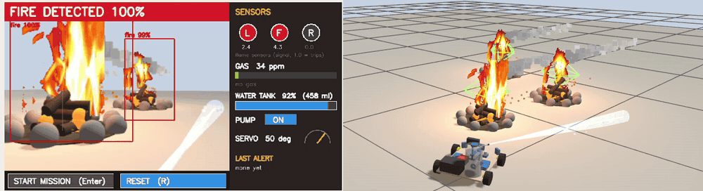
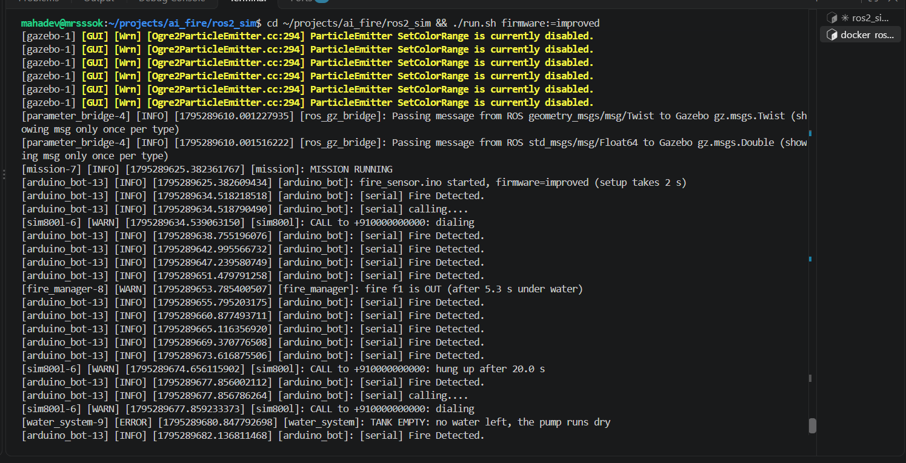
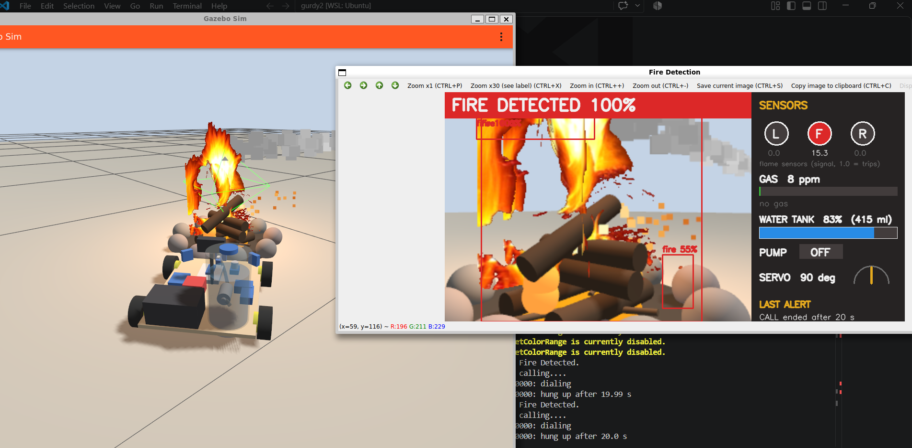
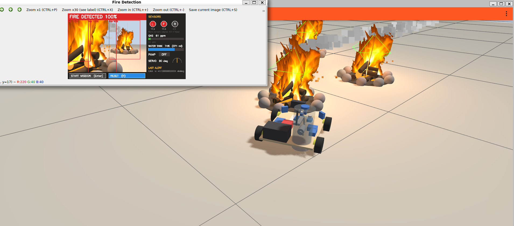
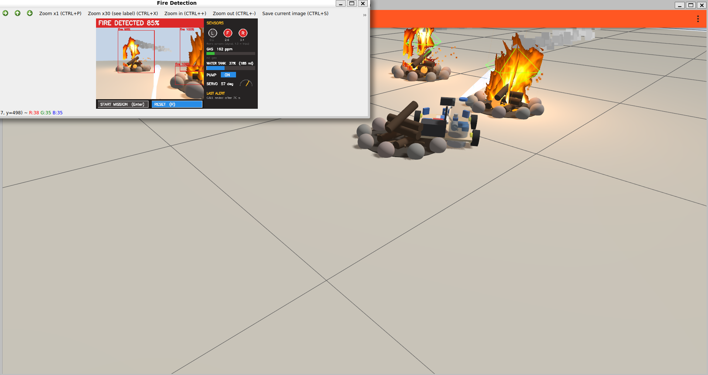
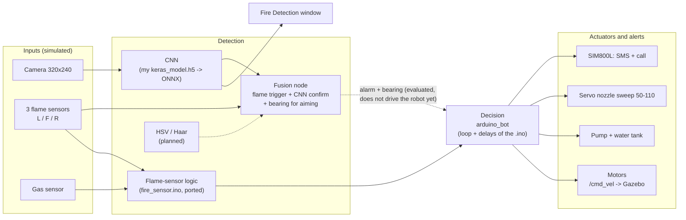
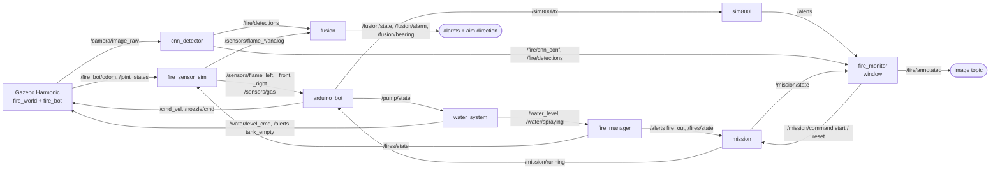

part-1 

hardware setup


[](https://github.com/user-attachments/assets/f9e05fa6-6d95-4072-93e8-d9cab5032dab)

part-2 

hardware setup 


hsv fire detection 


haar cascade model 


dataset := https://www.kaggle.com/datasets/atulyakumar98/test-dataset

we train the model using cascade trainer gui with the above images 


cnn model 

train a CNN (Convolutional Neural Network) model  using TensorFlow Keras to classify images as fire and. no fire

Database: https://www.kaggle.com/datasets/phylake1337/fire-dataset

model training : = https://colab.research.google.com/drive/1TbO_pBiTCtn0L5OkdX5SaEVEOY0zA8iE#scrollTo=bBZVol2PArKV

testing the model := https://colab.research.google.com/drive/1WOvQNlO0oBI94mtI9TmAuokz-i88wuzW?usp=sharing#scrollTo=xPUN897MaXq9


to run the model in raspberry pi 

```bash
source sttr/bin/activate
cd Desktop
python fire.py
```


---

## ROS 2 + Gazebo simulation (`ros2_sim/`)

My Arduino + Raspberry Pi fire-fighting robot rebuilt in **ROS 2 Jazzy + Gazebo Harmonic** (Docker): the Arduino logic of `fire_sensor.ino` is **ported line by line** (including its blocking `delay()`s), the camera detection runs **my own trained CNN** (`keras_model.h5`, converted to ONNX), and the robot, the water tank and the fires are simulated. Everything lives in [`ros2_sim/`](ros2_sim/); the original files above are untouched.



*Improved firmware (`firmware:=improved`): the SIM800 call runs in the background, so the pump stays ON while dialling; left: live detection panel (CNN 100%, flame sensors, water tank, pump, servo, alert), right: the robot spraying in Gazebo*



*Terminal log of the same run: the call is dialling while fire detection and spraying continue, fire f1 goes out after 5.3 s under water, then the 500 ml tank runs dry (water, not time, is the real limit)*



*1. The live Fire Detection window: robot camera with the CNN confidence banner (`FIRE DETECTED 100%`), boxes around fire regions, flame sensors L / F / R, gas level, water tank, pump, servo angle and the last SIM800L alert.*



*2. The robot driving to three realistic fires (pit of logs, flame photos on crossed planes, flicker, light, sparks and smoke).*



*3. Spraying: pump ON, servo-swept nozzle, the water jet hits the fire, one fire is already out and the tank level is dropping.*

### Real robot vs simulation

| | Real robot (this repo) | Simulation (`ros2_sim/`) |
|---|---|---|
| Flame sensors | 3 digital IR modules (left / front / right), LOW = flame | 3 virtual sensors: cone + inverse-square model on the fires; **range and angle are my assumptions**, not measured |
| Gas sensor | MQ-type digital output -> SMS | virtual sensor: concentration decays with distance from a gas-leaking fire (static, no spreading cloud) |
| Detection | Pi camera: Keras CNN (`fire.py`), Haar cascade (`haar_cascade.py`, `hsv.py`) | simulated camera (320x240, 10 Hz): **my CNN** runs; HSV colour rule only proposes boxes; Haar / HSV nodes are planned. **New:** a fusion node (flame sensors trigger, CNN confirms) and decoys (red / orange objects, sunlit window, hot lamp) to evaluate it |
| Control logic | `fire_sensor.ino` on the Arduino | `core/arduino_logic.py`: same pins, same delays (0.4 s loop, 0.5 s stop, servo 50-110-50 at 10 ms/deg, 7.15 s SMS, 20 s + 1 s call) |
| Pump + servo nozzle | relay + servo, sweep 50-110 deg | pump pin -> water use; the nozzle is on the servo horn and sweeps; the jet is a translucent visual (Gazebo particle emitters cannot be re-aimed) |
| Water tank | MCP3008 reading in `fire.py` | 500 ml, 25 ml/s **only while the pump runs**; `/water_level` in percent; level shown in the bottle; `tank_empty` alert |
| SMS / call | SIM800L AT commands | the same AT strings go to a SIM800L emulator that logs / publishes SMS and call events (no real message is sent). Default firmware = the `.ino` exactly (blocking); optional `firmware:=improved` runs the call / SMS in the background (**not** in the real `.ino`) |
| Fire | real combustion | photo cut-outs + light + particles; goes out after 4 s of full spray. **Looks nothing like a real fire to a camera in detail** |
| Real vs simulated | everything | simulated: sensors, camera, fires, water, GSM modem. Not simulated: real IR/camera noise, smoke, wind, wheel slip beyond Gazebo's physics, the Pi and the Arduino hardware |

### 1. Pipeline



### 2. ROS 2 nodes and topics



### 3. Mission state machine

The ported Arduino program does **not search**: it waits until a flame sensor sees fire.

```mermaid
stateDiagram-v2
  [*] --> Waiting
  Waiting --> Running: countdown ends or Start
  state Running {
    [*] --> WaitForFlame
    WaitForFlame --> Turn: side sensor sees flame
    Turn --> Approach: front sensor sees flame
    WaitForFlame --> Approach: front sensor sees flame
    Approach --> Spray: 0.4 s forward, then stop
    Spray --> Alert: pump + servo sweep 50-110-50
    Alert --> WaitForFlame: phone call 20 s, next loop (original firmware; the call runs in the background in firmware:=improved)
  }
  Running --> Done: all fires out
  Running --> TankEmpty: tank at 0 percent
  Waiting --> Waiting: Reset
  Running --> Waiting: Reset
  Done --> Waiting: Reset
  TankEmpty --> Waiting: Reset
```



`Done` shows `MISSION DONE: all fires out` and `TankEmpty` shows `TANK EMPTY: no water left`; neither closes or resets anything, the simulation keeps running until Ctrl+C. Reset puts the robot back, refills the tank and relights the fires.

### Findings

* **My CNN is a small binary Keras CNN, not a Teachable Machine model**: one sigmoid output, no labels file. On real photos the fire probability is `1 - output` (0..1 input scaling); it caught **18 of 19 real fires** but also flagged **27 of 35 hard non-fire photos** (many paintings and indoor scenes). Details: [`ros2_sim/docs/cnn_model.md`](ros2_sim/docs/cnn_model.md).
* **On the simulated fire** (robot camera, mean confidence): **0.98 at 0.6 m**, **0.68 at 1.0 m**, **0.30 at 1.6 m (missed)**; 0.27 looking away from every fire and 0.39 at the burnt-out pit ([`docs/cnn_sim_eval.json`](ros2_sim/docs/cnn_sim_eval.json)).
* **The firmware blocks for the phone call**: after each fire it waits 20 s (+1 s) in `delay()`, so it sprays only **~1.7 s per ~23 s cycle** (pump on **8 %** of the time). The motors also keep their last command during the 7 s SMS delay.
* **Non-blocking alert** (`firmware:=improved`, call / SMS as a background job, not in the real `.ino`; [`docs/results/alert_modes.md`](ros2_sim/docs/results/alert_modes.md), 3 runs each, 2 s of spray per fire, ideal sensors): all three fires were out after **~35 s instead of ~223 s** (6x faster, pump on 60 % of the time), but it used **more water, 479 ml vs 430 ml**, and in **1 of 3 runs the 500 ml tank ran dry** with the third fire still burning. With the default 4 s per fire neither firmware finishes ([`alert_modes_extinguish4.md`](ros2_sim/docs/results/alert_modes_extinguish4.md)): the tank is empty after 267 s with 2 of 3 fires out (original) vs after 28 s with 1 of 3 out (improved). Water, not time, is then the limit.
* **Flame-sensor + CNN fusion** ([`docs/results/fusion_eval.md`](ros2_sim/docs/results/fusion_eval.md): 3 scenarios x 6 seeds, the robot turns 360 deg among fires and decoys; false alarm = a decoy that raised an alarm):
  * *Fires only* (12 fires): flame sensors found 8 (the 4 missed were all farther than ~1.1 m), the **CNN found all 12 but gave 1 false alarm**, fused found 8 with 0 false alarms.
  * *Red / orange objects* (no IR; box, barrel, cone): the CNN alone raised an alarm on **14 of 18**, flame sensors and fused on **0 of 18**.
  * *Hot lamp and sunlit window* (bright and IR): **fusion does not help**: the lamp fooled all three methods (12 / 12) and the window 7 / 12 fused (8 / 12 flame, 12 / 12 CNN) because my CNN also rates them as fire. In `decoys only`, false alarms: flame 11 of 24 decoys, **CNN 21 of 24**, fused 11 of 24.
  * Fused can not see farther than the flame sensors (over all 24 fires: flame 7 missed, fused 8, CNN 0). Time to detect 3-5 s for all three; flame-sensor bearing within 5-14 deg of the truth.
* **`hsv.py` is really a Haar cascade** (with a servo sweep); the repo contains no HSV thresholding, and the model files the scripts load (`labels.txt`, the cascade XML) are not in the repo either.
* **Motor wiring assumption:** `fire_sensor.ino` drives the left motor when the *left* sensor fires, which turns the robot away from the fire unless the motor pins are wired mirrored. The simulation assumes mirrored wiring (`swap_motor_sides`, default true; `false` runs the pins exactly as written).
* In the default three-fire layout the robot reaches all fires and the mission ends with `MISSION DONE` with a 2 s extinguish time (276 s in my check run with `ros2_sim/scripts/check_mission.py`, 221-227 s in the evaluation runs); with the default 4 s the 500 ml tank runs out first. The simulation only runs at about real time (more `speed` just drifts the firmware's timing), so batch runs use `speed:=1.0`.
* `models/keras_model.h5` is 116 MB, above GitHub's file limit, so only the converted `fire_cnn.onnx` (39 MB) is in the repo.

### Next steps (planned, not done yet)

* HSV and Haar-cascade detector nodes on the same interface as the CNN, then compare them with the CNN and the fusion on the same decoy scenes (the CNN flags the lamp and the window, so a better cue is needed: flicker, shape or a retrained CNN).
* Let the fusion alarm and bearing drive the robot (today it only reports; the firmware still reacts to the raw flame sensors).
* A real fix for the "stands still when no sensor sees fire" behaviour (search pattern) and for the tank limit; the non-blocking alert alone does not finish the default 4 s mission.

### Run it

Needs Docker Desktop (WSL2 with WSLg for the Gazebo window) and the local image `gurdy2/ros:jazzy` (ROS 2 Jazzy + Gazebo Harmonic; the `ros2_sim/Dockerfile` builds on it).

```bash
cd ~/projects/ai_fire/ros2_sim
./run.sh                # Gazebo (camera follows the robot) + the Fire Detection window, half speed
./run.sh firmware:=improved   # same, with the call / SMS in the background
```

* The robot waits 15 s (countdown on the window) or until you press **Enter** (terminal) / click **START MISSION**.
* **R** (window) or **r + Enter** (terminal) = reset: robot back at the start, tank refilled, fires relit.
* `./run.sh speed:=1.0` = real time; `./run.sh start_delay:=0` = start at once; `./run.sh gui:=false monitor_window:=false` = headless. **Ctrl+C** quits.
* Tests: `docker run --rm -v $PWD/ros2_sim:/home/ubuntu/ros2_sim fire_ros2:jazzy bash -c 'source /opt/ros/jazzy/setup.bash; cd ~/ros2_sim/src/fire_robot_sim && python3 -m pytest -q'` (69 tests). Evaluations: `ros2_sim/scripts/eval_fusion.py`, `ros2_sim/scripts/eval_alert_modes.py` (commands in the `ros2_sim` README). More in [`ros2_sim/README.md`](ros2_sim/README.md).

**Tech stack:** ROS 2 Jazzy, Gazebo Harmonic (`ros_gz`, DiffDrive, particle emitters), xacro/URDF, Python 3.12, onnxruntime, OpenCV, NumPy, Keras CNN (converted to ONNX), Docker (WSL2 + WSLg), pytest.
