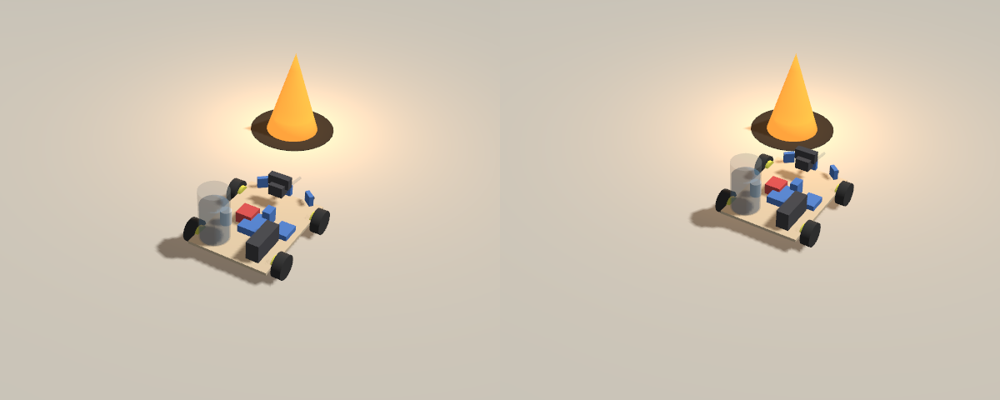

# ros2_sim: fire-fighting robot in ROS 2 Jazzy + Gazebo Harmonic

Simulation of the robots in this repo (the original files one level up are untouched). Design, fidelity rules,
the sim-vs-real fire caveat and the 8-step plan are in [docs/design.md](docs/design.md).

**Status: step 1 of 8**: robot + world + the Arduino flame-sensor behaviour (`fire_sensor.ino`). Camera detectors
(HSV / Haar / CNN), real fire textures + particles, spreading gas, water that puts fires out, and the Pi robot logic
come in the next steps.



*The fire is a placeholder (emissive cone + glow light on a solid pit). It is not a realistic fire yet.*

## What step 1 does

* **Robot** (xacro, `fire_robot_description`): flat board, four wheels, 3 flame sensors on the front edge, gas sensor,
  servo-swept nozzle (servo 50-110 deg like the code), pump, water-bottle tank, USB webcam (320x240, 10 Hz on
  `/camera/image_raw`), battery / L298N / SIM800L props. Geometry and sensor mounts live in
  `fire_robot_description/config/robot.yaml`.
* **World**: floor + 3 fires from `fire_robot_bringup/config/fires.yaml`. The first fire is inside the left sensor's
  cone, the others are for later steps / manual driving.
* **Sensors** (`fire_sensor_sim`): flame cone + inverse-square model per sensor, gas concentration around gas-emitting
  fires. Range, cone angle and gas decay are simulation parameters, not measurements of the real modules.
* **`arduino_bot`**: `fire_sensor.ino` ported line by line (`core/arduino_logic.py`) with its original delays: it
  stands still until a sensor sees flame, turns toward it, creeps forward 0.4 s per cycle when the front sensor sees it,
  then stops, pumps and sweeps the servo 50-110-50, and "calls" for 20 s. Gas: "Gas Detected" SMS (blocks 7.15 s while the
  motors keep running, like the original).
* **`sim800l`**: decodes the same AT commands (`AT+CMGS`, Ctrl-Z, `ATD...;`, `ATH`) into SMS / call events on `/alerts`.

## Run

Needs Docker Desktop (WSL2, WSLg for the Gazebo window) and the local image `gurdy2/ros:jazzy`
(ROS 2 Jazzy + Gazebo Harmonic + ros_gz; the `Dockerfile` builds on it).

```bash
cd ~/projects/ai_fire/ros2_sim
./run.sh                       # builds in Docker, opens Gazebo; the robot reacts to the fire on its left
./run.sh gui:=false            # headless
./run.sh autonomous:=false     # no Arduino program: drive with  ros2 topic pub /cmd_vel geometry_msgs/msg/Twist ...
./run.sh phone:="+91..."       # number shown in the simulated SMS / call (default is a placeholder)
./run.sh swap_motor_sides:=false   # run the motor pins exactly as written (see design.md)
```

Watch it: `ros2 topic echo /alerts`, `/sensors/flame_left/analog`, `/pump/state`, `/nozzle/cmd`.

## Tests

```bash
cd src/fire_robot_sim && python3 -m pytest        # pure Python + pytest: 19 tests (timing, pins, sensors, SIM800L)
# URDF checks need ROS: docker run --rm -v $PWD:/home/ubuntu/ros2_sim fire_ros2:jazzy bash -c \
#   'source /opt/ros/jazzy/setup.bash; cd ~/ros2_sim && colcon build --symlink-install && source install/setup.bash && cd src/fire_robot_description && python3 -m pytest test'
```

## Known limitations (step 1)

* Fires never go out yet (step 2), so the robot repeats the spray + call cycle forever.
* No occlusion for the flame sensors; the gas "cloud" is a static radial decay around gas fires.
* The Arduino robot does not search, so fires outside the three sensor cones are ignored.
* The nozzle joint lags the 100 deg/s servo sweep a little (position-controller gains).
