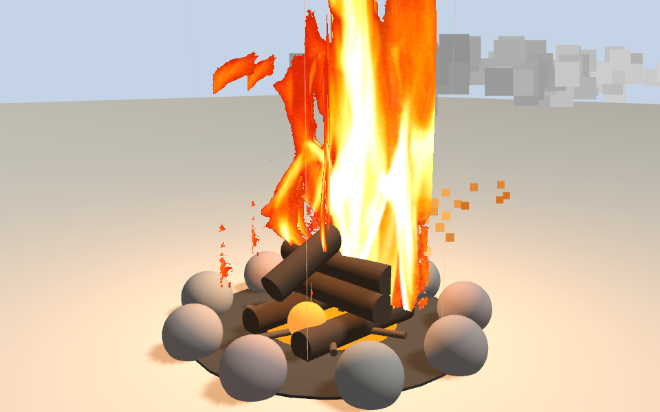
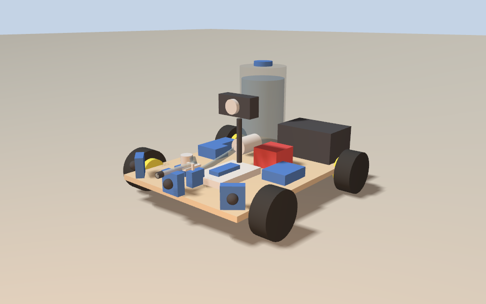
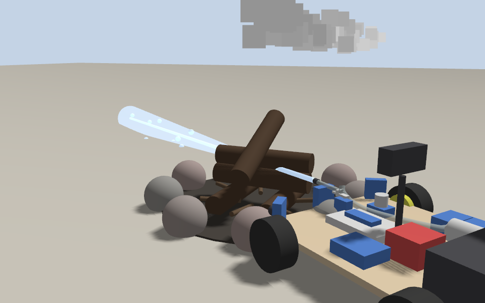
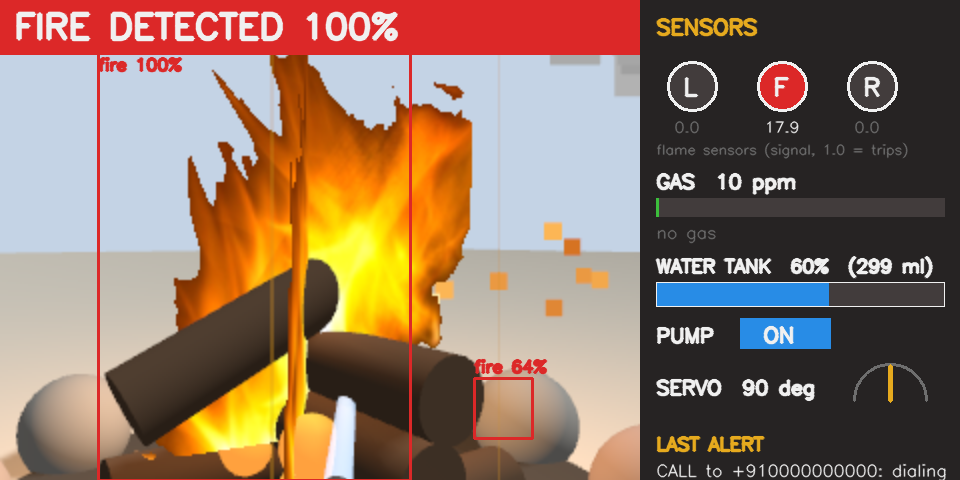
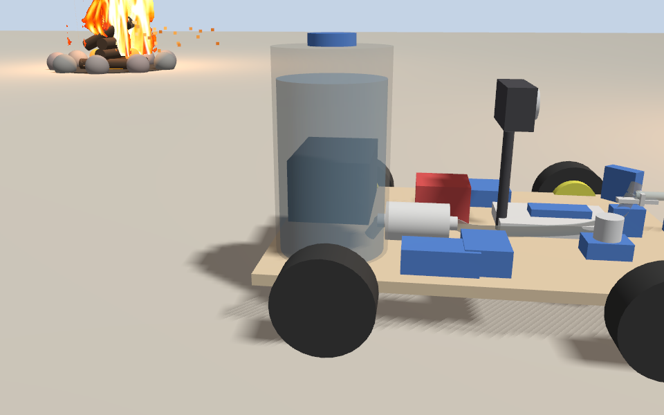
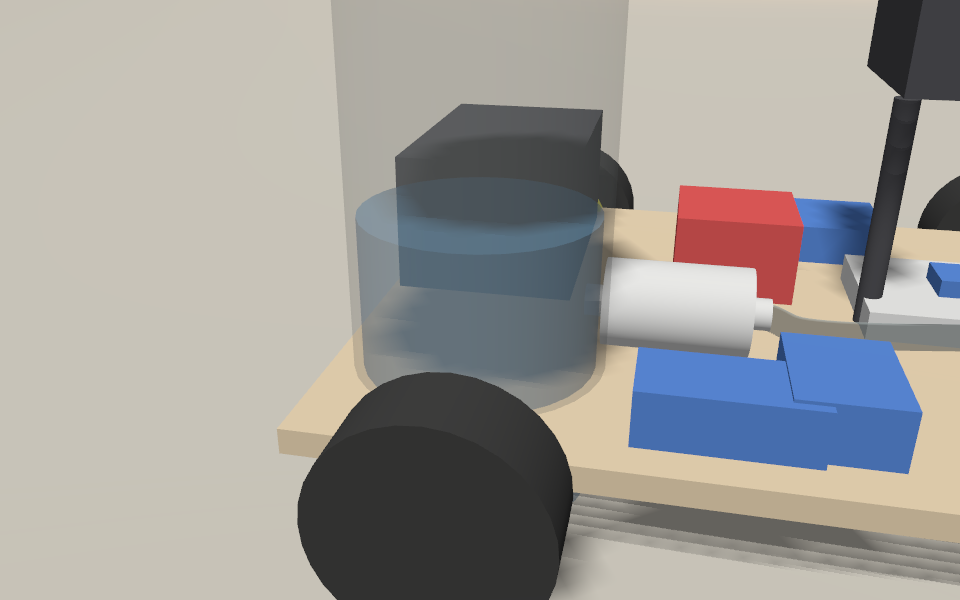

# ros2_sim: fire-fighting robot in ROS 2 Jazzy + Gazebo Harmonic

Simulation of the robots in this repo (the original files one level up are untouched). Design, fidelity rules,
the sim-vs-real fire caveat and the 8-step plan are in [docs/design.md](docs/design.md).

**Status: step 2 of 8**: realistic fires, water system, the CNN from `keras_model.h5`, a live detection window and a robot
model that follows the photo. Next: HSV/Haar detectors + the Pi robot logic, fusion, decoys and an evaluation
(see the plan in [docs/design.md](docs/design.md)).

| | |
|---|---|
|  |  |
| *Fire: charred logs + stones, flames = crossed billboard planes with real flame photos, flicker, light, sparks, smoke* | *Robot: board, 4 wheels, bottle tank rear right, black battery, red L298N, SIM800L, breadboard + Arduino, gas module, webcam, flame sensors on the front edge, servo + nozzle* |
|  |  |
| *The nozzle sits on the servo horn and sweeps; the jet is only shown while the pump sprays* | *Live "Fire Detection" window (also on `/fire/annotated`)* |
|  |  |
| *Tank before the fire fight...* | *...and after: the level only drops while the pump sprays* |

The simulated fire is a stack of photo cut-outs, particles and a point light. It is **not** combustion and looks
different from a real fire to a camera (no real flicker statistics, glare, smoke density or sensor noise). Anything
measured on it says little about real-world performance, see "How good is the CNN" below.

## What it does

* **Fires** (`fire_manager`): pit with logs; frame swap + random turn ~8x/s, three sizes, own flickering light, sparks and
  smoke emitters. The water jet (a narrow cone from the swept nozzle) lowers a fire's intensity: 4 s of full-strength
  spray (parameter `extinguish_time`) puts it out; the flames shrink, then only embers, then out, and the smoke fades last.
  `/fires/state` has the intensities; flame sensors and gas follow them.
* **Water** (`water_system`): 500 ml tank, pump 25 ml/s (`config/robot.yaml`), consumed **only while the pump pin is on**.
  `/water_level` is a percent like the MCP3008 reading in `fire.py`; the water body in the transparent bottle sinks with it.
  At 0 the jet stops and `{"type": "tank_empty"}` is published on `/alerts` (try `./run.sh tank_percent:=8`).
* **CNN** (`cnn_detector`): the project's `keras_model.h5`, converted to `models/fire_cnn.onnx`, see
  [docs/cnn_model.md](docs/cnn_model.md). `/fire/cnn_conf`, `/fire/detections` (HSV-proposed regions classified by the CNN).
* **Live window** (`fire_monitor`): robot camera + banner (`FIRE DETECTED 93%` red / `NO FIRE 12%` green from the CNN
  confidence) + boxes + side panel (flame sensors L/F/R, gas, tank %, pump, servo angle, last alert). It opens next to
  Gazebo (`monitor_window:=false` to disable) and is published as `/fire/annotated`.
* Everything from step 1 still applies (Arduino logic port, SIM800L emulator, flame/gas sensors).

## How good is the CNN (honest)

The model is a small binary Keras CNN; fire confidence = 1 - sigmoid output (determined on real photos, see
`docs/cnn_model.md`: 95% of 19 real fires flagged, but also 77% of 35 mixed non-fire photos). On the simulator camera
(`scripts/eval_cnn_sim.py`, `docs/cnn_sim_eval.json`, mean fire confidence over ~5 s per view):

| view of fire f1 | mean confidence | frames >= 0.5 |
|---|---|---|
| 1.6 m away | 0.30 | 0% |
| 1.0 m | 0.68 | 95% |
| 0.6 m | 0.98 | 100% |
| fire at the edge of the view, 1.0 m | 0.47 | 43% |
| looking away from every fire | 0.27 | 0% |
| all fires out (charred logs, fading smoke), 0.6 m | 0.39 | 0% |

So it detects a close, centred simulated fire confidently, misses a distant one, and never fires on the empty scene or the
burnt-out pit. The distant miss is why the plan has a fusion step: the flame sensors trigger and the CNN confirms.

## Run

Needs Docker Desktop (WSL2, WSLg for the Gazebo window) and the local image `gurdy2/ros:jazzy`
(ROS 2 Jazzy + Gazebo Harmonic + ros_gz; the `Dockerfile` builds on it).

```bash
cd ~/projects/ai_fire/ros2_sim
./run.sh                       # builds in Docker, opens Gazebo + the Fire Detection window; the robot reacts to the fire on its left
./run.sh gui:=false monitor_window:=false   # headless
./run.sh extinguish_time:=8    # harder fires
./run.sh tank_percent:=8       # nearly empty tank -> tank_empty alert
./run.sh autonomous:=false     # no Arduino program: drive with  ros2 topic pub /cmd_vel geometry_msgs/msg/Twist ...
./run.sh phone:="+91..."       # number shown in the simulated SMS / call (default is a placeholder)
./run.sh swap_motor_sides:=false   # run the motor pins exactly as written (see design.md)
```

Watch it: `ros2 topic echo /alerts`, `/sensors/flame_left/analog`, `/pump/state`, `/nozzle/cmd`.

## Tests

```bash
# pure logic, overlay, world generator, ONNX interface: 39 tests (needs numpy/OpenCV/onnxruntime: easiest in the image)
docker run --rm -v $PWD:/home/ubuntu/ros2_sim fire_ros2:jazzy bash -c \
  'source /opt/ros/jazzy/setup.bash; cd ~/ros2_sim/src/fire_robot_sim && python3 -m pytest -q'
# URDF checks need the built workspace: colcon build && source install/setup.bash && cd src/fire_robot_description && python3 -m pytest test
```

Screenshots are made with `scripts/doc_shots.py` against a sim launched with `shot_camera:=true`; the flame textures with
`assets/make_flame_sprites.py` (credits: [assets/CREDITS.md](assets/CREDITS.md)).

## Known limitations

* Gazebo particles are flat squares and cannot be re-aimed at runtime, so smoke and sparks look blocky up close and the
  water jet is built from translucent visuals instead of particles.
* Flames are cut-out photos on crossed planes; they light the scene through point lights only.
* The Arduino robot stays stationary until a flame sensor sees fire and repeats its 21 s call cycle, so a fire takes
  several minutes of simulated time to put out (it only sprays 1.7 s per cycle).
* No occlusion for the flame sensors; the gas "cloud" is a static radial model that follows the fire's intensity.
* `models/keras_model.h5` (116 MB) is git-ignored (GitHub's 100 MB limit); the converted ONNX (39 MB) is committed.
